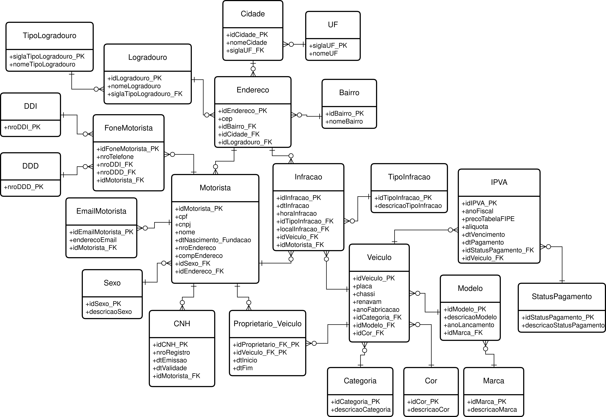
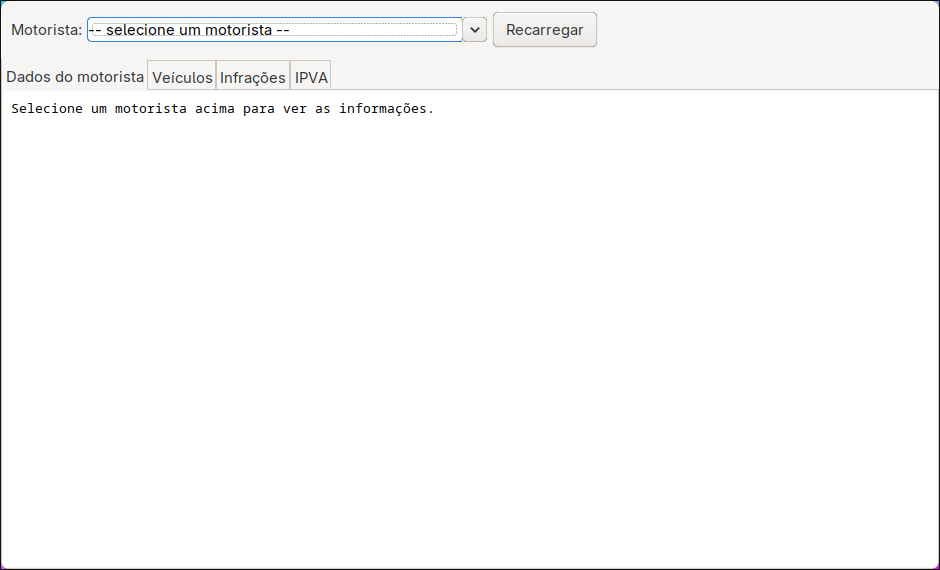
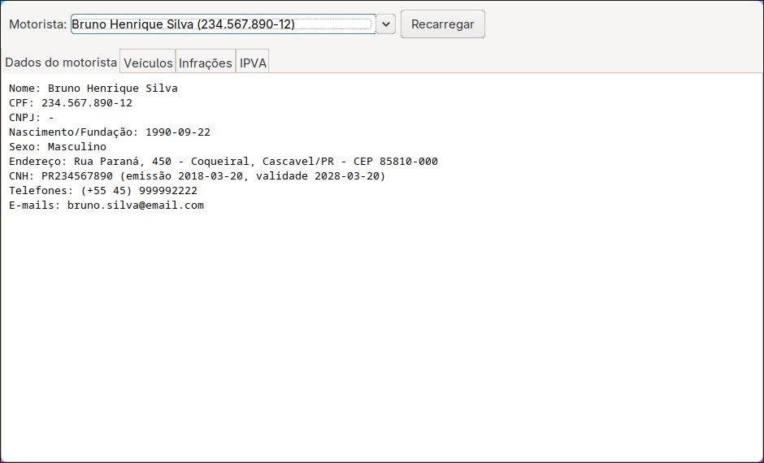
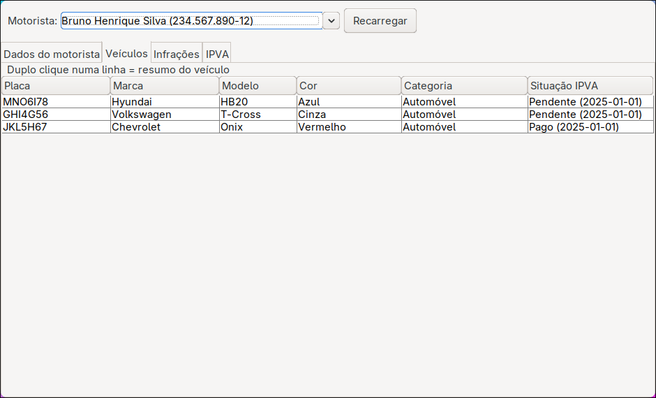
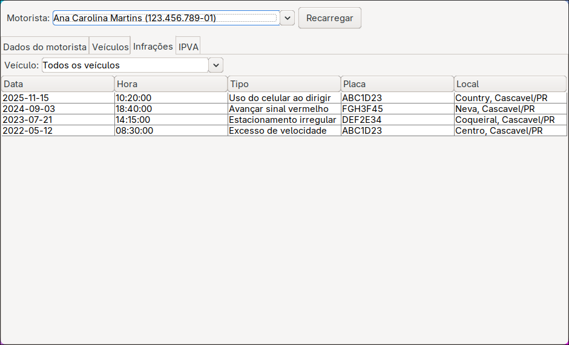
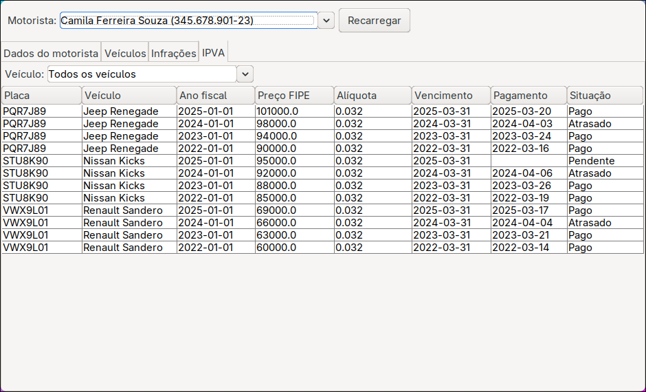

# Implementação de sistema de registro de veículos do Detran

**Matéria:** Banco de dados.

**Professor:** Roberto Gil Brasil.

**Estudantes:** [Julia Gabrielly](https://github.com/yuchenkkao), [Marcos Sousa](https://github.com/molsousa).

## Descrição

Este repositório contém a implementação de um sistema de registro de veículos do Detran para a disciplina de Banco de Dados.

## Implementação

O programa foi todo implementado em `Java 8` e fora utilizado o `postgresql` como o banco de dados. Em [sql/](./sql/) é possível consultar as tabelas e inserts que utilizamos para criar o banco.

Para a consultar os dados, foi utilizado interface gráfica em Java usando `javax.swing.*`.

## Modelo Entidade-Relacionamento

Segue abaixo o Modelo Entidade-Relacionamento planejado para esse trabalho.

<div align="center">
    
</div>

## Estrutura dos pacotes

```ASCII
├── sql/
│   ├── DadosBanco.sql
│   └── TabelaBanco.sql
└── src/
    └── registro_veiculo/
        ├── connection/
        │   └── ConnectionFactory.java
        ├── dao/
        │   ├── InfracaoDAO.java
        │   ├── IpvaDAO.java
        │   ├── MotoristaDAO.java
        │   └── VeiculoDAO.java
        ├── model/
        │   ├── CNH.java
        │   ├── EmailMotorista.java
        │   ├── Endereco.java
        │   ├── FoneMotorista.java
        │   ├── IPVA.java
        │   ├── Infracao.java
        │   ├── Marca.java
        │   ├── Modelo.java
        │   ├── Motorista.java
        │   └── Veiculo.java
        └── view/
            ├── viewMain.java
            └── viewTeste.java
```

## Interface gráfica

Segue abaixo uma figura com a tela que aparecerá assim que o código for executado.

<div align="center">
    
</div>

Abaixo como fica a tela após selecionar um dos motoristas.

<div align="center">
    
</div>

Caso selecione um motorista, aparecerá os seus veículos.

<div align="center">
    
</div>

Abaixo uma tela para mostrar todas as infrações de um motoristas.

<div align="center">
    
</div>

Abaixo o histórico de IPVA de um motorista.

<div align="center">
    
</div>

---
